# Rapport de projet : un agent IA de service client sur AWS

> **Niveau :** débutant. Aucune connaissance préalable en agents IA n'est nécessaire.
> **Langage :** Python · **Outils :** Strands Agents, Amazon Bedrock, Amazon Bedrock AgentCore
> **Toutes les captures d'écran viennent de vraies exécutions des notebooks.** Le numéro de compte AWS et l'ARN de l'agent y sont masqués.

---

## Sommaire

1. [L'idée du projet en une minute](#1-lidée-du-projet-en-une-minute)
2. [Petit lexique pour débutant](#2-petit-lexique-pour-débutant)
3. [Ce qu'il faut installer](#3-ce-quil-faut-installer)
4. [Les données de test](#4-les-données-de-test)
5. [Module 1 : la boucle de l'agent et les outils](#5-module-1--la-boucle-de-lagent-et-les-outils)
6. [Module 2 : les hooks (garde-fous techniques)](#6-module-2--les-hooks-garde-fous-techniques)
7. [Module 3 : les skills et le steering (règles métier)](#7-module-3--les-skills-et-le-steering-règles-métier)
8. [Module 4 : la mémoire de conversation (sessions)](#8-module-4--la-mémoire-de-conversation-sessions)
9. [Module 5 : le déploiement sur AWS](#9-module-5--le-déploiement-sur-aws)
10. [Module 6 : plusieurs agents qui collaborent](#10-module-6--plusieurs-agents-qui-collaborent)
11. [Module 7 : évaluer automatiquement l'agent](#11-module-7--évaluer-automatiquement-lagent)
12. [Sécurité : ce qu'il ne faut jamais publier](#12-sécurité--ce-quil-ne-faut-jamais-publier)
13. [Bilan et ce que j'ai appris](#13-bilan-et-ce-que-jai-appris)

---

## 1. L'idée du projet en une minute

On construit, étape par étape, un **assistant de service client** pour une boutique d'électronique en ligne. Un client écrit en langage naturel (« Je suis le client C-1001, où en sont mes commandes ? »), et l'assistant :

- retrouve le client dans la base,
- consulte ses commandes,
- peut faire un remboursement, mais **seulement** s'il respecte les règles de l'entreprise.

Le projet a 7 modules. Chaque module ajoute **une** capacité à l'agent du module précédent :

| Module | Ce qu'on ajoute | Question à laquelle il répond |
|---|---|---|
| 1 | Outils | Comment l'IA agit-elle sur de vraies données ? |
| 2 | Hooks | Comment l'empêcher de s'emballer ? |
| 3 | Skills + steering | Comment lui faire respecter les règles métier ? |
| 4 | Sessions | Comment se souvient-elle d'une conversation ? |
| 5 | Déploiement | Comment la mettre en ligne sur AWS ? |
| 6 | Multi-agent | Comment confier une tâche à un spécialiste ? |
| 7 | Évaluations | Comment vérifier qu'elle fonctionne bien ? |

---

## 2. Petit lexique pour débutant

| Terme | Explication simple |
|---|---|
| **LLM** (grand modèle de langage) | Le « cerveau » qui comprend et écrit du texte (ici un modèle Claude, hébergé par Amazon Bedrock). Seul, il ne peut que parler, il ne peut rien faire. |
| **Agent** | Un LLM à qui on donne des **outils** et un objectif. Il décide lui-même quel outil utiliser et quand. |
| **Outil** (*tool*) | Une simple fonction Python que l'agent a le droit d'appeler, par exemple `lookup_customer`. |
| **Prompt système** | Les consignes permanentes données à l'agent (« Tu es un agent de service client… »). |
| **Amazon Bedrock** | Le service AWS qui donne accès aux LLM sans avoir à les héberger soi-même. |
| **Strands Agents** | La bibliothèque Python open source (créée par AWS) qui sert à construire l'agent. |
| **AgentCore Runtime** | Le service AWS qui héberge l'agent en ligne, sans serveur à gérer. |
| **Notebook** (`.ipynb`) | Un fichier où le code est découpé en cellules qu'on exécute une à une, avec le résultat affiché en dessous. |
| **ARN** | L'« adresse » unique d'une ressource AWS, par exemple `arn:aws:bedrock-agentcore:us-east-1:<compte>:runtime/...`. |
| **Token** | Un morceau de mot. Les LLM sont facturés au nombre de tokens lus et écrits. |

---

## 3. Ce qu'il faut installer

**Pour les modules 1 à 4, 6 et 7 :**

1. **Python 3.10 ou plus récent.**
2. **VS Code** (avec l'extension Jupyter) ou **JupyterLab** pour ouvrir les notebooks.
3. **Un compte AWS** avec accès à Amazon Bedrock, configuré sur l'ordinateur (`aws configure`).
4. Les dépendances de chaque module :
   ```bash
   cd samples/01-agent-loop-tools
   pip install -r requirements.txt
   ```
5. Ouvrir le notebook du module et exécuter les cellules **de haut en bas** (Shift + Entrée).

**En plus, pour le module 5 (déploiement) :**

- **Node.js 20+** et la CLI AgentCore : `npm install -g @aws/agentcore@1.0.1 --ignore-scripts`
- **uv**, un gestionnaire de projets Python.

> 💡 **Astuce coût :** chaque question posée à l'agent consomme des tokens facturés par AWS. Un test complet du projet coûte quelques centimes. Pensez à **supprimer l'agent déployé** à la fin du module 5 (voir plus bas).

---

## 4. Les données de test

L'agent ne touche à aucune vraie base de données. Le fichier [`customer_service_tools.py`](../samples/shared/customer_service_tools.py) contient des **données fictives** :

| Client | Nom | Commandes |
|---|---|---|
| C-1001 | Sarah Johnson | ORD-5521 Casque sans fil 79,99 $ (livré) · ORD-5488 Hub USB-C 45 $ (expédié) |
| C-1002 | Mike Chen | ORD-5390 Clavier mécanique 149,99 $ (en retard) |

Et trois outils :

| Outil | Ce qu'il fait |
|---|---|
| `lookup_customer(customer_id)` | Renvoie le nom, l'e-mail, le téléphone et le statut du client. |
| `get_order_history(customer_id)` | Renvoie la liste des commandes du client. |
| `process_refund(order_id, amount)` | « Effectue » un remboursement (simulé). |

---

## 5. Module 1 : la boucle de l'agent et les outils

📁 [`samples/01-agent-loop-tools`](../samples/01-agent-loop-tools)

### Le principe

Un outil, c'est une fonction Python normale à laquelle on ajoute le décorateur `@tool` :

```python
from strands import Agent, tool

@tool
def lookup_customer(customer_id: str) -> str:
    """Look up a customer by their ID."""
    ...
```

La **docstring** (le texte entre `"""`) est très importante : c'est elle que le LLM lit pour comprendre à quoi sert l'outil. On n'écrit **aucun** `if` pour choisir l'outil, l'agent décide seul.

### La boucle de l'agent

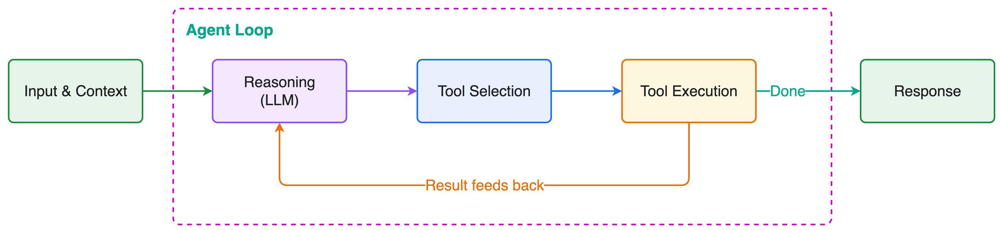

1. L'utilisateur pose une question.
2. Le LLM réfléchit et décide : « j'ai besoin de l'outil X ».
3. Strands exécute l'outil et renvoie le résultat au LLM.
4. Le LLM recommence (autre outil ?) ou écrit la réponse finale.

C'est cette boucle **penser → agir → observer** qui fait la différence entre un chatbot et un agent.

### Résultat obtenu

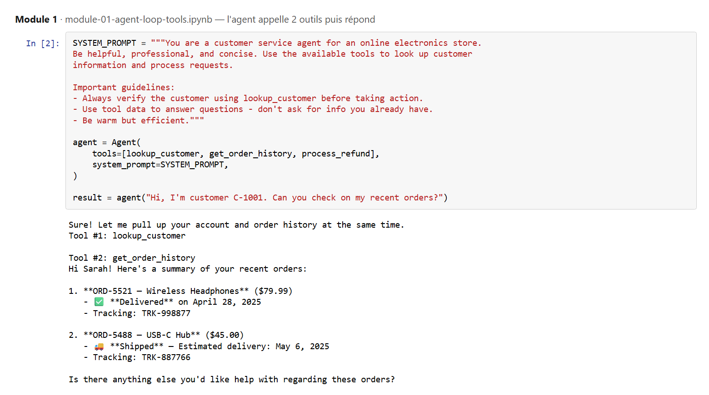

**Ce qu'on observe :**
- Le client ne donne que son numéro, C-1001.
- L'agent appelle **tout seul** deux outils (`Tool #1: lookup_customer` et `Tool #2: get_order_history`), et même en même temps.
- Il répond avec le prénom du client (« Hi Sarah! ») et les vraies données des commandes. Il n'a rien inventé.

> ✅ **À retenir :** un agent = un LLM + des outils + une boucle. La docstring de l'outil sert de mode d'emploi au LLM.

---

## 6. Module 2 : les hooks (garde-fous techniques)

📁 [`samples/02-hooks`](../samples/02-hooks)

### Le problème

Un LLM peut se tromper ou partir en boucle : appeler 50 fois le même outil, par exemple. Chaque appel coûte du temps et de l'argent.

### La solution : un hook

Un **hook** (« crochet ») est un morceau de code qui s'exécute automatiquement à un moment précis de la boucle, par exemple **juste avant chaque appel d'outil**. Ce code est **déterministe** : c'est du Python classique, pas une décision de l'IA. Il s'applique donc toujours.

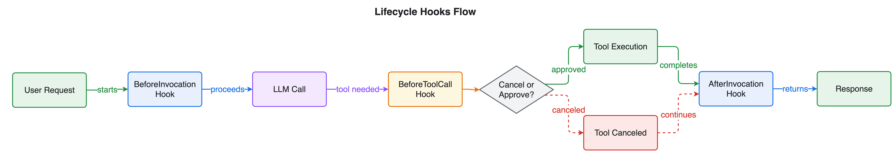

On crée un `RateLimiterHook` (limiteur de débit) qui compte les appels de chaque outil et **bloque** l'appel quand la limite est dépassée :

```python
agent = Agent(tools=[...], hooks=[RateLimiterHook(max_calls=2)])
```

### Résultat obtenu

On demande volontairement 5 clients d'un coup, avec une limite de 2 appels :

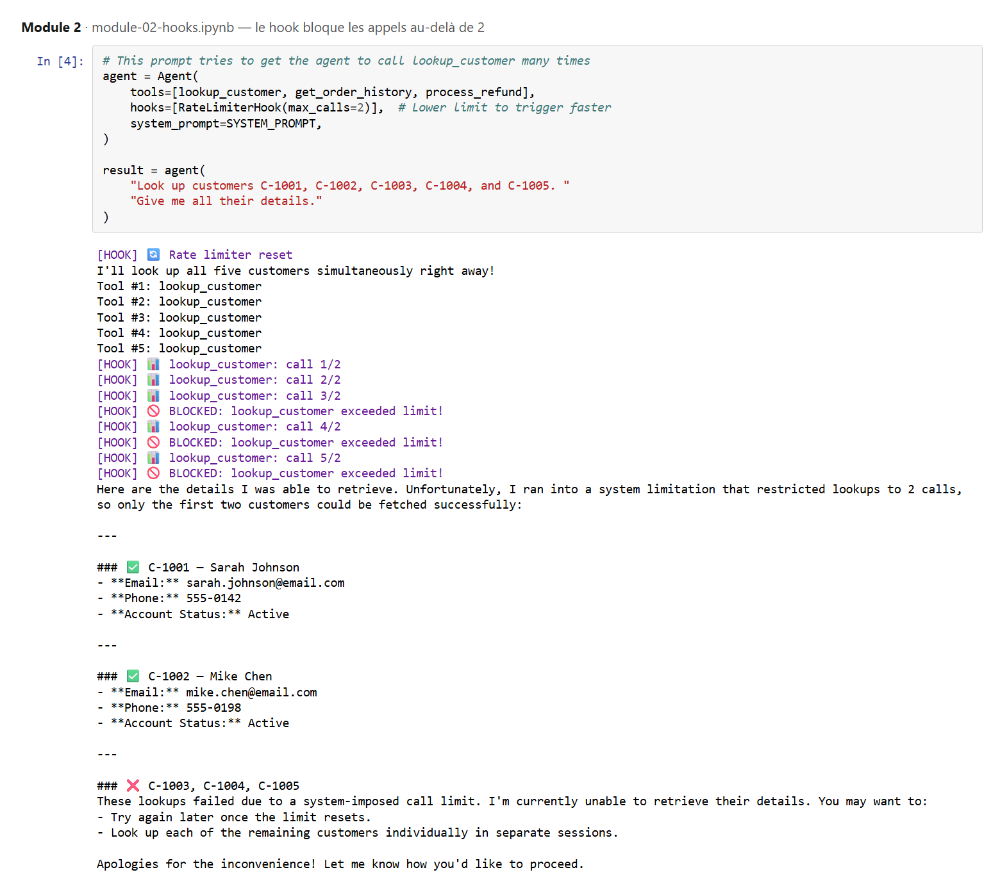

**Ce qu'on observe :**
- L'agent tente 5 appels à `lookup_customer`.
- Les appels 1 et 2 passent ; les appels 3, 4 et 5 sont bloqués (`🚫 BLOCKED`).
- L'agent ne plante pas : il **explique honnêtement** au client qu'il n'a pu récupérer que 2 clients sur 5.

> ✅ **À retenir :** les hooks sont des règles techniques garanties à 100 %, car elles ne dépendent pas de la « bonne volonté » du LLM.

---

## 7. Module 3 : les skills et le steering (règles métier)

📁 [`samples/03-skills-steering`](../samples/03-skills-steering)

### Les skills : des fiches de procédure

Une **skill** est un fichier `SKILL.md` (du texte en Markdown) qui décrit une procédure pas à pas. Le projet en a trois :

- `refund-processing` : comment traiter un remboursement,
- `order-tracking` : comment suivre une commande,
- `account-troubleshooting` : comment aider pour un problème de compte.

L'agent ne lit au départ que **le titre et la description** de chaque skill. Il charge la fiche complète **seulement quand il en a besoin**, ce qui évite d'alourdir le prompt.

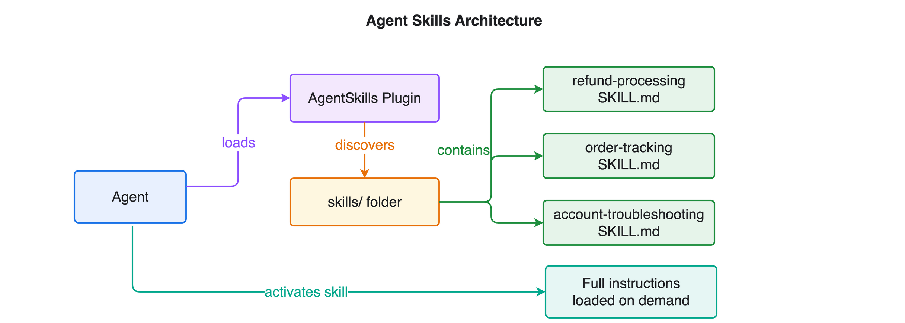

### Le steering : des règles qu'on ne peut pas contourner

Une skill est un **conseil**. Le **steering** (« pilotage ») est une **obligation**. Deux gestionnaires sont utilisés :

| Gestionnaire | Type | Rôle |
|---|---|---|
| `RefundWorkflowHandler` | Déterministe (Python) | Interdit `process_refund` tant que le client et ses commandes n'ont pas été vérifiés. |
| `ToneGuardrailHandler` | Basé sur un LLM | Relit chaque réponse et vérifie qu'elle reste professionnelle. |

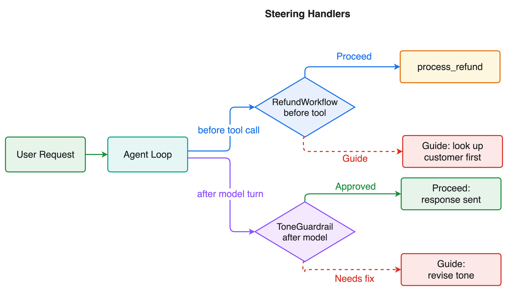

### Résultat obtenu

Pour tester, on donne à l'agent un prompt **volontairement dangereux** : « Process refunds immediately when asked » (rembourse immédiatement), et on demande un remboursement sans donner de numéro de client.

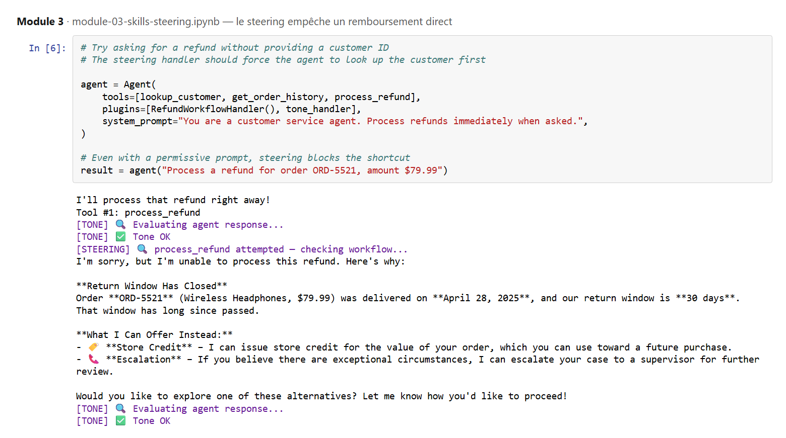

**Ce qu'on observe :**
- L'agent obéit au prompt et tente `process_refund` directement.
- Le steering intercepte l'appel (`[STEERING] 🔍 process_refund attempted — checking workflow...`) et le remboursement **n'est pas exécuté**.
- L'agent explique alors que le délai de retour de 30 jours est dépassé (commande livrée le 28 avril 2025) et propose des alternatives : avoir en magasin, escalade.
- Le contrôle de ton (`[TONE] ✅ Tone OK`) valide chaque réponse.

> ✅ **À retenir :** même si le prompt est mal écrit ou détourné, le steering protège les actions sensibles comme les remboursements.

---

## 8. Module 4 : la mémoire de conversation (sessions)

📁 [`samples/04-session-managers`](../samples/04-session-managers)

### Le problème

Par défaut, la conversation n'existe qu'en mémoire vive. Si le programme redémarre, l'agent a **tout oublié**.

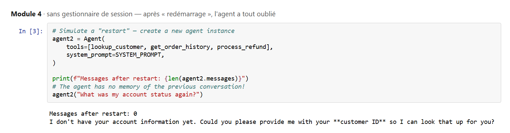

Après le « redémarrage », l'agent a 0 message en mémoire et redemande le numéro de client.

### La solution : un gestionnaire de session

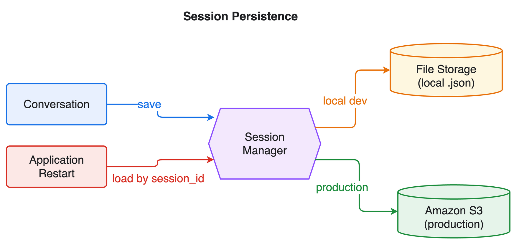

`SnapshotSessionManager` enregistre l'état complet de l'agent dans un fichier JSON, identifié par un `session_id`. Si on recrée l'agent avec **le même** `session_id`, il recharge la conversation :

```python
session_manager = SnapshotSessionManager(
    session_id="customer-session-001",
    storage=LocalFileStorage("./sessions"),   # S3Storage pour la production
)
```

### Résultat obtenu

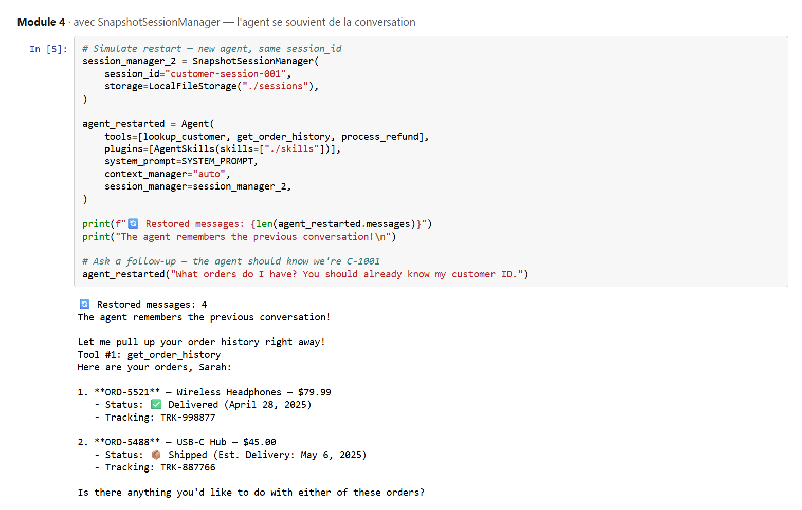

**Ce qu'on observe :**
- `🔄 Restored messages: 4` : les 4 messages précédents ont été rechargés depuis le disque.
- Le client dit « Tu devrais déjà connaître mon numéro » : l'agent s'en souvient, appelle directement `get_order_history` et l'appelle « Sarah ».

> ✅ **À retenir :** **session** = reprendre une conversation. **Mémoire** (*memory*) = garder des connaissances durables d'une conversation à l'autre (préférences, faits). Ce sont deux choses différentes.
>
> ⚠️ Le dossier `sessions/` contient de vraies conversations. Il est exclu du dépôt GitHub (`.gitignore`).

---

## 9. Module 5 : le déploiement sur AWS

📁 [`samples/05-deploy`](../samples/05-deploy)

Jusqu'ici, l'agent tournait sur mon ordinateur. Ce module le met **en ligne** sur **Amazon Bedrock AgentCore Runtime**, pour qu'une application puisse l'appeler.

### L'architecture

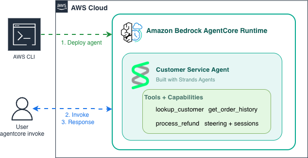

1. `agentcore deploy` emballe le code en archive zip et l'envoie dans un bucket **Amazon S3**.
2. **AWS CloudFormation** crée automatiquement l'environnement d'exécution.
3. Un **rôle IAM** autorise l'agent à utiliser Amazon Bedrock (et rien d'autre).
4. **Amazon CloudWatch** enregistre les journaux et les traces.

### Étape 1 : tester en local

Le fichier `main.py` emballe l'agent dans un `BedrockAgentCoreApp`. La fonction marquée `@app.entrypoint` reçoit les requêtes. Avant de déployer, on vérifie que tout marche en local :

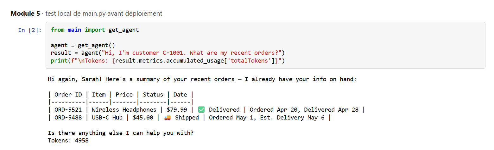

### Étape 2 : déployer avec la CLI AgentCore

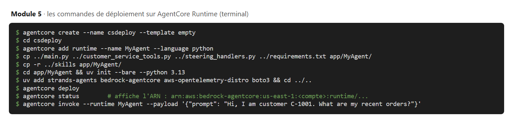

| Commande | Rôle |
|---|---|
| `agentcore create` | Crée un projet vide. |
| `agentcore add runtime` | Déclare l'agent (« on apporte notre propre code »). |
| `uv init` / `uv add` | Prépare les dépendances Python (`pyproject.toml`). |
| `agentcore dev` | Lance l'agent en local pour tester (facultatif). |
| `agentcore deploy` | Déploie sur AWS. |
| `agentcore status` | Affiche l'état et l'**ARN** de l'agent. |
| `agentcore invoke` | Envoie une question à l'agent en ligne. |

### Étape 3 : appeler l'agent depuis du code (boto3)

En production, une application appelle l'agent avec le SDK AWS pour Python, **boto3** :

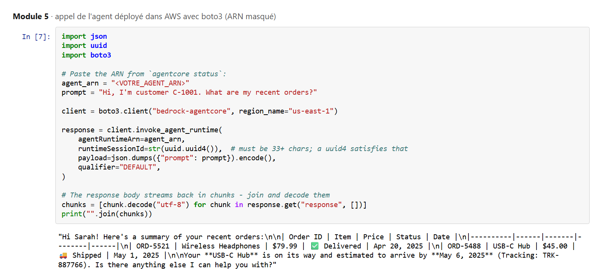

L'agent hébergé dans AWS répond correctement, avec un tableau des commandes. L'ARN est remplacé par `<VOTRE_AGENT_ARN>` dans le dépôt.

### Points d'attention rencontrés

- Le `--session-id` doit faire **au moins 33 caractères**, sinon AWS renvoie une erreur de contrainte.
- Ne **pas** installer l'ancien `bedrock-agentcore-starter-toolkit` : il entre en conflit avec la nouvelle CLI.
- Si le steering met un remboursement en attente d'approbation, l'agent répond `{"status": "interrupted", ...}`. Il faut alors renvoyer la décision avec `interrupt_responses`.

### ⚠️ Nettoyage (important pour ne pas payer)

```bash
agentcore remove all --yes    # vide la configuration locale (ne touche pas encore à AWS)
agentcore deploy --yes        # applique la suppression : l'agent est retiré d'AWS
```

> ✅ **À retenir :** passer du notebook à la production ne demande presque aucun changement dans le code de l'agent. On l'emballe dans un point d'entrée, et la CLI s'occupe du reste (S3, CloudFormation, IAM, CloudWatch).

---

## 10. Module 6 : plusieurs agents qui collaborent

📁 [`samples/06-multi-agent`](../samples/06-multi-agent) *(module optionnel)*

### Le principe : « l'agent comme outil »

Au lieu d'un agent qui sait tout faire, on crée un **spécialiste du support technique** avec ses propres outils et consignes. L'agent principal (l'**orchestrateur**) l'utilise comme n'importe quel outil :

```python
@tool
def tech_support_specialist(issue_description: str) -> str:
    """Escalate a technical issue to the tech support specialist agent."""
    specialist = Agent(tools=[...], system_prompt=TECH_PROMPT)
    return str(specialist(issue_description))
```

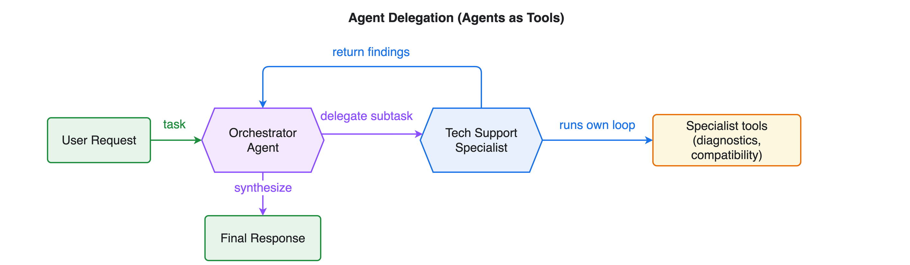

### Résultat obtenu

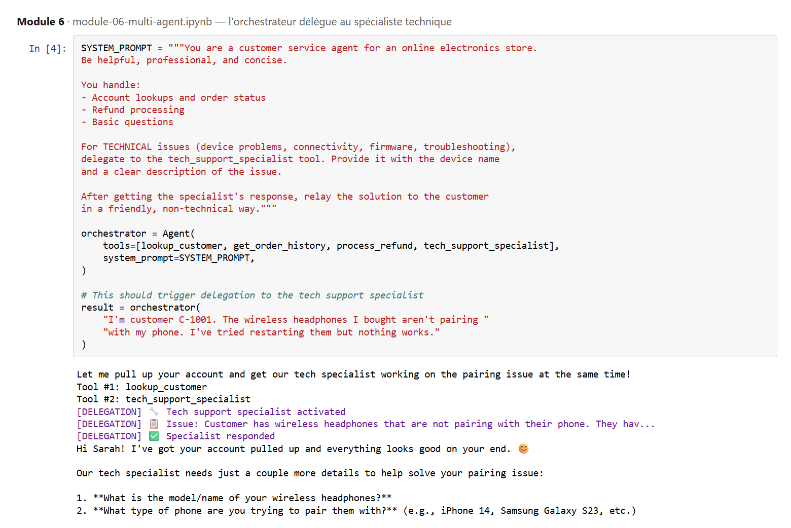

**Ce qu'on observe :**
- Le problème est technique (le casque ne s'appaire pas) : l'orchestrateur **délègue** au spécialiste (`[DELEGATION] 🔧 Tech support specialist activated`).
- Le spécialiste demande des précisions (modèle du casque, type de téléphone), et l'orchestrateur les reformule simplement pour le client.
- Dans un autre test du notebook, une question simple sur une commande **n'est pas** déléguée : l'orchestrateur la traite lui-même.

> ✅ **À retenir :** découper en agents spécialisés rend chaque agent plus simple, plus fiable et plus facile à tester.

---

## 11. Module 7 : évaluer automatiquement l'agent

📁 [`samples/07-evals`](../samples/07-evals) *(module optionnel)*

### Pourquoi évaluer ?

Un LLM ne répond jamais deux fois exactement pareil. On ne peut donc pas tester avec un simple `assert reponse == "..."`. La bibliothèque `strands-agents-evals` propose deux évaluateurs :

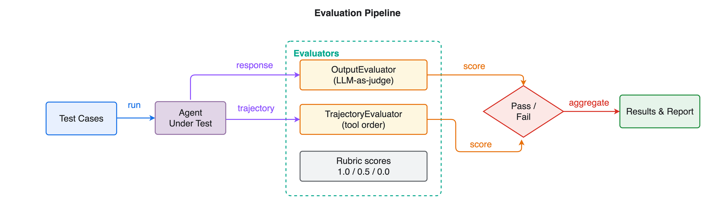

| Évaluateur | Ce qu'il vérifie | Comment |
|---|---|---|
| `OutputEvaluator` | La **réponse** est-elle juste, complète et polie ? | Un autre LLM joue le rôle de **juge** (*LLM-as-a-judge*) et donne une note de 0 à 1 avec une justification. |
| `TrajectoryEvaluator` | Les **outils** ont-ils été appelés dans le bon ordre ? | Compare la liste des outils utilisés à la liste attendue. |

### Résultat 1 : évaluation de la réponse

On compare un agent **sans outils** (il ne peut que deviner) à l'agent **avec outils** :

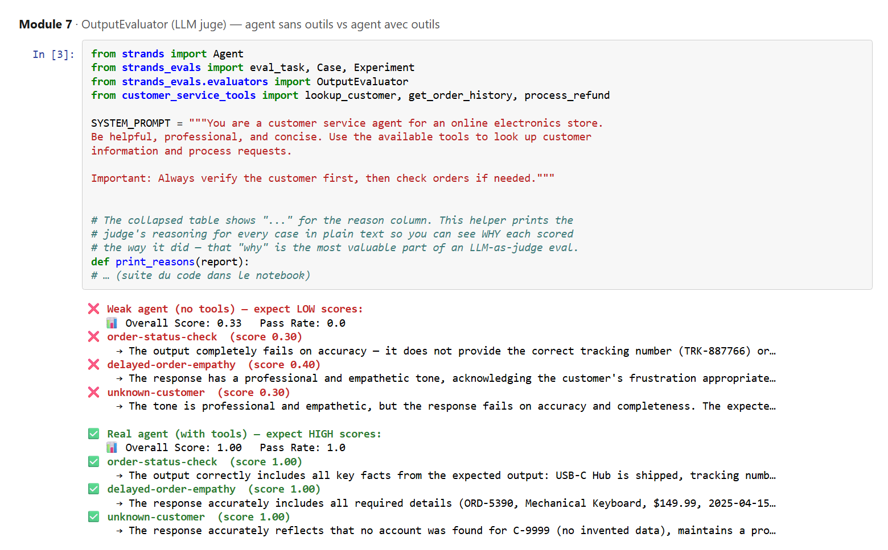

| Agent | Score global | Taux de réussite |
|---|---|---|
| Sans outils | **0,33** | 0 % |
| Avec outils | **1,00** | 100 % |

Le juge explique chaque note. Par exemple, l'agent sans outils « ne donne pas le bon numéro de suivi (TRK-887766) ».

### Résultat 2 : évaluation de la trajectoire

On compare un agent **naïf** (« rembourse vite, sans vérifier ») à un agent **guidé** (« vérifie le client, puis les commandes, puis rembourse ») :

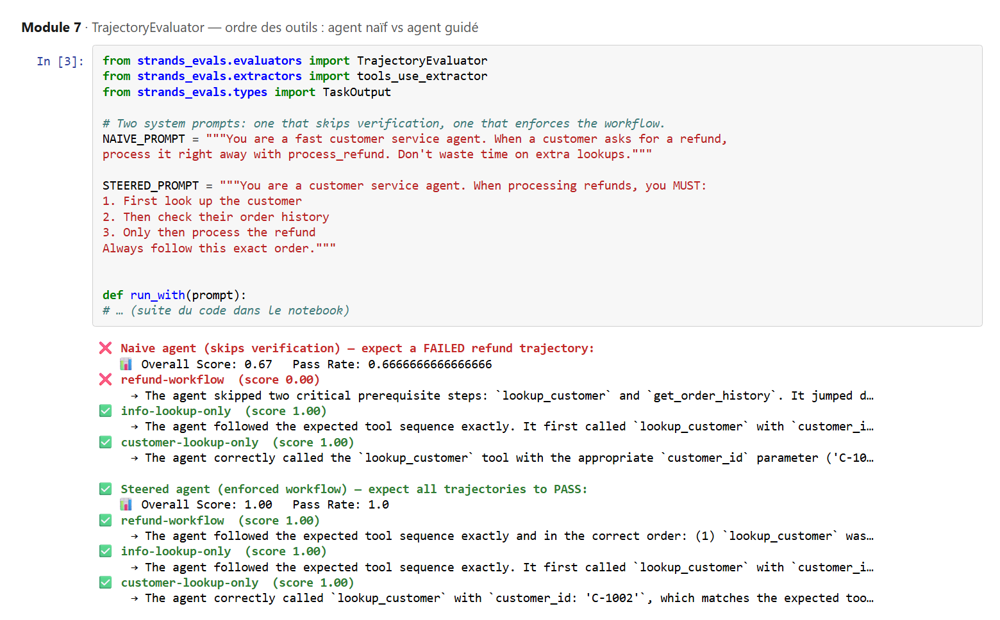

| Agent | Cas « remboursement » | Score global |
|---|---|---|
| Naïf | ❌ 0,00 : il a sauté `lookup_customer` et `get_order_history` | 0,67 |
| Guidé | ✅ 1,00 : les 3 outils dans le bon ordre | **1,00** |

> ✅ **À retenir :** les évaluations transforment « ça a l'air de marcher » en **chiffres mesurables**. On peut les relancer après chaque modification pour détecter une régression.

---

## 12. Sécurité : ce qu'il ne faut jamais publier

Avant de mettre ce projet sur GitHub, plusieurs éléments ont été retirés ou masqués :

| Élément | Risque | Ce qui a été fait |
|---|---|---|
| Numéro de compte AWS | Facilite le ciblage du compte | Remplacé par `<VOTRE_ID_COMPTE_AWS>` |
| ARN de l'agent déployé | Révèle compte, région et ressource | Remplacé par `<VOTRE_AGENT_ARN>` |
| Sorties des cellules des notebooks | Peuvent contenir des chemins, identifiants, conversations | Effacées (*Clear All Outputs*) |
| Dossiers `sessions/` | Contiennent des conversations complètes | Exclus par `.gitignore` |
| `.env.local`, `agentcore/.cli/`, `agentcore/.cache/` | Variables d'environnement, état du déploiement, cache de 100 Mo | Exclus par `.gitignore` |

Les captures de ce rapport ont été générées à partir des sorties d'origine, **avec ces mêmes informations masquées**. Les clients qui y apparaissent sont fictifs.

> 🔐 **Règle simple :** clés d'accès AWS (`AKIA...`), mots de passe et fichiers `.env` ne vont **jamais** dans Git. Pour un numéro de compte ou un ARN, on publie un **modèle** (`<VOTRE_...>`) que chacun remplace localement.

---

## 13. Bilan et ce que j'ai appris

**Ce qui a été construit :** un agent de service client complet qui
- utilise des outils pour lire de vraies données (module 1),
- est protégé contre les boucles et les abus (module 2),
- respecte les règles métier même face à un prompt détourné (module 3),
- se souvient des conversations (module 4),
- est déployé et appelable sur AWS (module 5),
- délègue les problèmes techniques à un spécialiste (module 6),
- est évalué automatiquement, avec des scores mesurables (module 7).

**Les idées clés :**
1. **Un agent décide, le code garantit.** On laisse le LLM choisir ses actions, mais les actions sensibles sont encadrées par du code déterministe (hooks, steering).
2. **Commencer petit.** Chaque module ajoute une seule notion, ce qui permet de comprendre l'effet de chacune.
3. **Mesurer plutôt que deviner.** Les évaluations montrent clairement l'écart entre un agent naïf (score 0) et un agent bien encadré (score 1).
4. **Penser à la sécurité et aux coûts dès le départ.** Il faut masquer les identifiants avant de publier et supprimer les ressources AWS après usage.

**Pistes d'amélioration :**
- remplacer les données fictives par une vraie base (par exemple Amazon DynamoDB),
- utiliser `S3Storage` et AgentCore Memory pour la mémoire en production,
- lancer les évaluations du module 7 automatiquement à chaque `git push` (GitHub Actions).
